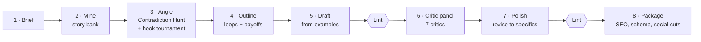

<p align="center">
  
</p>

<p align="center">
  <a href="LICENSE"></a>
  <a href="https://github.com/tejalogs/writers-room/actions/workflows/tests.yml"></a>
  
  
  
</p>

# Writers' Room: the AI writing skill for podcast scripts, blogs and social posts

**Writers' Room is an open-source agent skill that makes AI write non-fiction people actually finish.** It gives any AI agent (Claude Code, Codex, Cursor, Gemini CLI, Antigravity or a local model) a professional writers' room: craft guides distilled from the great non-fiction writers, an eight-stage pipeline, a critic panel and a code linter that catches generic "AI slop" before it ships.

It writes **podcast scripts** (solo, two-host, interview), **blog posts** structured for SEO and AI answer engines (AEO/GEO), **social posts** (LinkedIn, X threads, captions, YouTube descriptions), **ads** (Google, Meta, LinkedIn), **landing pages**, and **video scripts** with shots, voice-over and on-screen text (video ads, Reels, Shorts, TikTok), all built on true stories, never invented ones. Examples cover SaaS, health, finance, travel and careers.

> Most AI writing tools fix the words after the fact. Writers' Room fixes the thinking first: the angle, the hook, the story and the structure. Then it checks the words.

---

## See the difference

<table>
<tr><th width="50%">Typical AI draft</th><th width="50%">With Writers' Room</th></tr>
<tr>
<td>In today's competitive job market, many candidates find it difficult to secure interviews despite submitting numerous applications.</td>
<td>She sent 212 applications in four months. Two people wrote back. Both were automated.</td>
</tr>
<tr>
<td>Rejection can be very challenging and can significantly impact your confidence. It's important to stay positive and remember that every rejection is a learning opportunity.</td>
<td>After the ninth rejection she stopped opening the emails. She'd see the subject line and archive it unread. By the time anyone gave her real feedback, she'd stopped believing feedback existed.</td>
</tr>
<tr>
<td>Now that we've covered why CVs fail, let's look at how to fix them.</td>
<td>So the CV wasn't the problem. Which raises a worse question: if it wasn't the CV, what were recruiters actually rejecting?</td>
</tr>
</table>

<sub>Illustrative teaching examples from <a href="skills/writers-room/craft/examples.md"><code>craft/examples.md</code></a>. In real pieces every detail must come from your story bank or a cited source.</sub>

---

## What makes it different

| | |
|---|---|
| 🎣 **Hooks that earn the next line** | 8 hook types, a hook stack for long pieces, and a 10-hook tournament judged pairwise with order-swapping |
| 🧵 **Narrative that holds** | Open loops with a ledger, "but/therefore" bridges, re-hooks every ~90 seconds, scenes, callbacks and endings |
| 🧠 **Thinking before writing** | The Contradiction Hunt, behaviour-first angles, conceptual collisions and six storytelling devices |
| 🚫 **Zero slop, measured** | The linter flags stock phrases, watch-word density, "not X but Y" contrasts, vague attributions, tidy morals and monotone rhythm |
| ✅ **Truth by design** | Never invents stories, quotes or stats: gaps become `[NEEDS STORY]`. Critics check frequency claims and invented thoughts |
| 🔎 **SEO + AEO built in** | Answer blocks, question-shaped H2s, self-contained sections, information gain, FAQ and JSON-LD |
| 🎙️ **Written for the ear** | Podcast rules for sentence length, signposting, numbers and two-host dynamics, plus a script format with delivery markers |
| 🎬 **A filmmaker layer for video** | A/V tables with timecodes, a shot vocabulary, devices turned into pictures, sound-off design, AI-video prompts, and a linter that checks hook timing, on-screen text and voice-over pace |
| 🎯 **Ads and landing pages** | Awareness levels, platform limits, variant matrices, message match, features → outcomes, real-proof rules and ad-policy guardrails for health, finance and jobs |
| 🏷️ **Any brand, your voice** | Brand packs with voice samples, compliance rules the linter enforces, and a private story bank |
| 🤏 **Small-model aware** | One stage per call; small models generate while larger models or humans judge, following the evidence |
| 📈 **Learns what works** | A performance log (clicks, AI citations, listen-through, leads) feeds back into angle and hook choice |

---

## How it works



Every stage saves its output, so you can review the angle and outline before a single paragraph is drafted.

---

## Install

**Any agent, via the skills CLI** (needs Node.js 22.20 or newer; check with `node -v`)
```bash
npx skills add tejalogs/writers-room
```

**No Node, or an older version? One command, no dependencies**
```bash
git clone --depth 1 https://github.com/tejalogs/writers-room /tmp/writers-room && mkdir -p .agents/skills && cp -r /tmp/writers-room/skills/writers-room .agents/skills/
```
This installs the skill into the current project's `.agents/skills/` folder, which Antigravity, Codex and Gemini CLI read. For Claude Code, use `~/.claude/skills/` instead.

**Claude Code plugin**
```text
/plugin marketplace add tejalogs/writers-room
/plugin install writers-room@writers-room
```

**Manual (Claude Code, Codex, Gemini CLI, Antigravity)**
```bash
git clone https://github.com/tejalogs/writers-room
cp -r writers-room/skills/writers-room ~/.claude/skills/     # Claude Code
cp -r writers-room/skills/writers-room .agents/skills/       # Codex, Gemini CLI, Antigravity (this project)
```

**Cursor, Copilot and other AGENTS.md agents:** clone into your project; [`AGENTS.md`](AGENTS.md) points the agent at the skill.

**Claude.ai:** zip `skills/writers-room` and upload it under Settings → Capabilities → Skills.

**Any API or local model:** use [`SKILL.md`](skills/writers-room/SKILL.md) plus [`principles.md`](skills/writers-room/craft/principles.md) as the system prompt, and run each [`pipeline/`](skills/writers-room/pipeline) file as one step.

---

## Use it

Just say what you want:

```text
Write a blog on why strong CVs get no callbacks. Keyword "no interview callbacks", UK grads.
Write a 12-minute two-host podcast script on why finishing a course isn't the same as being able to do it.
Turn this idea into a LinkedIn post: <idea>
Write 5 Meta ad variants and a 30-second video ad for our budgeting app. Audience: problem-aware.
Write landing page copy for our physio clinic's free assessment. Traffic comes from Google search.
Here's my draft, make it better: <paste>
```

If the format isn't clear, the skill asks one question: blog, podcast, social post, ad, landing page, video script, or one idea → all formats.

---

## Set up your brand (5 minutes)

```bash
mkdir -p .writers-room && cp -r <skill-dir>/brand-template/* .writers-room/
```

Fill in `.writers-room/BRAND.md`: audience, beliefs you overturn, voice, compliance and, most importantly, **2–3 samples of writing you're proud of**. Mirror your compliance rules in `brand.json` so the linter enforces them. Keep `.writers-room/` private if your story bank holds customer material.

### Feed it true stories

```bash
python3 skills/writers-room/scripts/anonymize.py call.txt --names "Priya,Rahul" > call.anon.txt
```

The anonymiser strips emails, phones, URLs, postcodes, IDs and names. **Read its output yourself**: no tool catches every name. Then ask your agent to "mine `call.anon.txt` into stories" and approve each one.

---

## The linter

```bash
python3 skills/writers-room/scripts/lint.py draft.md --mode blog --brand .writers-room/brand.json
python3 skills/writers-room/scripts/lint.py script.md --mode podcast
python3 skills/writers-room/scripts/lint.py video-ad.md --mode video    # A/V table: hook timing, on-screen text, VO pace
```

```text
draft.md: 2 errors, 3 warnings, 1 notes
  ERROR L1  [throat-clearing] Opens with throat-clearing: In this article, we will explore...
  ERROR L14 [banned-phrase] "it's worth noting" reads as generic/machine-written
  WARN      [not-x-but-y] 3x: "It's not X, it's Y" contrasts: once per piece at most
  WARN      [vague-attribution] "studies show": name the source or cut the claim
  WARN      [answer-first] "How many jobs should I apply to?": lead with a short direct answer
  INFO      [needs-marker] [NEEDS SOURCE: callback rate]
```

Flagged sentences go back through a **revise loop**: rewrite toward a concrete noun, number, named source or the person's own words, never a synonym swap.

---

## What's inside

```text
skills/writers-room/
├── SKILL.md                  entry point (Agent Skills format)
├── craft/                    the writing knowledge
│   ├── principles.md         the bar + seven ship tests
│   ├── hooks.md              8 hook types, hook stack, AEO-friendly hooks
│   ├── bridges-and-loops.md  but/therefore, open loops, re-hooks, payoffs
│   ├── narrative.md          scenes, character, pacing, persuasion arc, ethics
│   ├── word-craft.md         clichés, machine tells, zombie nouns
│   ├── masters.md            McPhee, Ira Glass, Gladwell, Zinsser, Orwell, Pinker, Feynman…
│   ├── examples.md           before/after pairs, model passages, SaaS/health/finance/travel
│   ├── podcast-structure.md  writing for the ear, episode arc, script format
│   ├── blog-structure.md     post types, anatomy for scanner/reader/answer engine
│   ├── social-structure.md   LinkedIn, X, captions, descriptions
│   ├── ads-structure.md      awareness levels, platform limits, variants, ad policy
│   ├── landing-page-structure.md  hero, sections, features → outcomes, proof, CTAs
│   ├── video-structure.md    the filmmaker layer: shots, A/V tables, on-screen text, AI video
│   ├── seo-aeo.md            intent, question mining, quotable chunks, schema
│   ├── banned-phrases.txt    multi-word phrases (linter ERROR)
│   └── watch-words.txt       single words (linter WARN by density)
├── pipeline/                 00 mine transcripts → 08 package
├── evals/                    critic panel, pairwise judge, scenarios, fixture brand
├── scripts/                  lint.py · anonymize.py · compare.py (stdlib only)
└── brand-template/           copy this to create your brand pack
```

---

## Built on evidence

The craft comes from the masters of non-fiction. The mechanics come from research:

- **Banning words in the prompt backfires.** Telling a model what not to say primes it (the "pink elephant" effect), so the skill drafts from examples and lints afterwards. [Antislop, ICLR 2026](https://arxiv.org/abs/2510.15061)
- **Slop is structural, not just vocabulary.** Contrast patterns and over-used trigrams matter alongside words. [EQ-Bench slop-score](https://github.com/sam-paech/slop-score) · [Wikipedia: Signs of AI writing](https://en.wikipedia.org/wiki/Wikipedia:Signs_of_AI_writing)
- **Small models are poor judges of writing.** 7–8B judges agree with humans only ~58–60% of the time, so small models generate and larger models or humans judge. [LitBench](https://arxiv.org/abs/2507.00769)
- **Position bias is real.** Every pairwise judgement is run twice with the order swapped. [Shi et al.](https://arxiv.org/abs/2406.07791)
- **Examples teach style better than rules.** Two good samples do most of the work. [Style-imitation study](https://arxiv.org/abs/2509.14543)
- **Outlines improve coherence.** [DOC](https://arxiv.org/abs/2212.10077)
- **Quotes, statistics and citations raise AI-search visibility.** [GEO, KDD 2024](https://arxiv.org/abs/2311.09735)

---

## Prove it on your own model

[`evals/RUNNING.md`](skills/writers-room/evals/RUNNING.md) has seven scenarios (blog, podcast, social, video ad, landing page, and "no material: must not invent"), a fictional brand pack, and `compare.py` to compare lint results with and without the skill across model sizes.

---

## FAQ

**Is this an AI humanizer?**
No. Humanizers rewrite finished text to dodge detectors. Writers' Room works upstream on the angle, story, hook and structure, and checks the words at the end. The goal is writing worth reading, not detector evasion.

**Does it work with ChatGPT, Gemini or local models?**
Yes. It's plain Markdown plus two small Python scripts. With small local models, run one stage per call and let a larger model or a human judge the options.

**Will it make up statistics or testimonials?**
It's designed not to. Missing material becomes `[NEEDS STORY]` or `[NEEDS SOURCE]`, and the Truth Editor critic checks quotes, numbers, frequency claims ("most people…") and invented thoughts.

**Can I use it for ads, video ads and landing pages?**
Yes. There are dedicated guides for text and image ads (Google, Meta, LinkedIn), landing pages, and video scripts with shots and on-screen text. The linter has a video mode, and the critic panel adds a Director, a Media Buyer and a Conversion Editor.

**Is it only for career content?**
No. The first examples follow one job-hunting story so you can see a single thread, and `examples.md` shows every hook type and rewrite in SaaS, health, finance and travel too.

**Does it support my language?**
The craft is language-neutral. The banned and watch lists and the linter heuristics are English-only for now; contributions welcome.

---

## Contributing

Ideas, new formats, better examples and translations are welcome. Read [CONTRIBUTING.md](CONTRIBUTING.md): changes to craft need evidence or a before/after that proves they help.

## License

[MIT](LICENSE). Use it, fork it, ship it.
