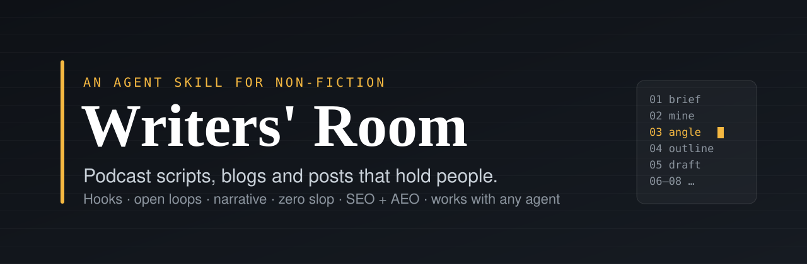

<p align="center">
  
</p>

<p align="center">
  <a href="LICENSE"></a>
  <a href="https://github.com/tejalogs/writers-room/actions/workflows/tests.yml"></a>
  
  
  
</p>

# Writers' Room: the AI writing skill for podcast scripts, blogs and social posts

Writers' Room is an open-source agent skill for **podcast scripts** (solo, two-host, interview), **blog posts** built for search and AI answer engines (SEO/AEO), **social posts**, **ads** (Google, Meta, LinkedIn), **landing pages** and **video scripts** with shots, voice-over and on-screen text. It runs in Claude Code, Codex, Cursor, Gemini CLI and Antigravity, or with any model you can give a system prompt, including small local ones.

You ask for a piece. The agent then works the way an editor would make a junior writer work: it collects the real story or the sourced facts first, agrees an angle and an outline with you, drafts from examples, and runs a linter and seven critics before handing you a file. When it has no real story or source for something, it leaves a marked gap (`[NEEDS STORY]`, `[NEEDS SOURCE]`) instead of making one up.

The craft rules come from non-fiction writers and editors (McPhee, Ira Glass, Zinsser, Orwell, Pinker, Roy Peter Clark and others). The mechanics come from research on how language models write and judge writing. Examples cover SaaS, health, finance, travel and careers.

---

## See the difference

<table>
<tr><th width="50%">Typical AI draft</th><th width="50%">With Writers' Room</th></tr>
<tr>
<td>In today's competitive job market, many candidates find it difficult to secure interviews despite submitting numerous applications.</td>
<td>She sent 212 applications in four months. Two people wrote back. Both were automated.</td>
</tr>
<tr>
<td>Rejection can be very challenging and can significantly impact your confidence. It's important to stay positive and remember that every rejection is a learning opportunity.</td>
<td>After the ninth rejection she stopped opening the emails. She'd see the subject line and archive it unread. By the time anyone gave her real feedback, she'd stopped believing feedback existed.</td>
</tr>
<tr>
<td>Now that we've covered why CVs fail, let's look at how to fix them.</td>
<td>So the CV wasn't the problem. Which raises a worse question: if it wasn't the CV, what were recruiters actually rejecting?</td>
</tr>
</table>

<sub>Illustrative teaching examples from <a href="skills/writers-room/craft/examples.md"><code>craft/examples.md</code></a>. In real pieces every detail must come from your story bank or a cited source.</sub>

---

## What's in it

| Part | What it does |
|---|---|
| **Story bank, interview and research** | Real moments from your calls (anonymised), an interview when the piece is about you, and a claims table with a source and date for every fact |
| **Angle stage** | The Contradiction Hunt (what people believe vs what happens to them), conceptual collisions, six storytelling devices, and ten hooks compared in pairs |
| **Structure** | Open loops tracked in a ledger, "but/so" between beats instead of "and then", a re-hook roughly every 90 seconds in audio, callbacks to the opening |
| **Checkpoints** | The agent stops after the angle and after the outline so you can redirect it before anything is drafted |
| **Linter** | Scores each draft out of 100. It flags stock phrases, clustered filler words, "not X but Y" contrasts, unsourced statistics, repeated sentence openers, mixed spelling, platform character limits and video timing |
| **Critic panel** | Seven critics, each checking one thing and quoting the sentence it objects to. The Truth Editor checks every quote, number and "most people…" claim |
| **Format guides** | Podcast (writing for the ear, two-host rules), blog (search and answer-engine structure), social, ads (awareness levels, policy rules), landing pages, and video (shots, A/V tables, sound-off design) |
| **Brand packs** | Your voice samples, compliance rules the linter enforces, and a private story bank |
| **Lite path** | A four-stage version with a one-page cheat sheet for 4–8B local models. The small model writes, code checks, and a larger model or you choose |
| **Feedback loop** | A performance log (clicks, AI citations, listen-through, leads) that informs the next angle and hook |

---

## How it works

```mermaid
flowchart LR
    A[1 · Brief] --> B[2 · Mine<br/>story bank]
    B --> R[2b · Research<br/>claims table]
    R --> C[3 · Angle<br/>Contradiction Hunt<br/>+ hooks]
    C --> P1{{You pick}}
    P1 --> D[4 · Outline<br/>loops + payoffs]
    D --> P2{{You approve}}
    P2 --> E[5 · Draft<br/>from examples]
    E --> L1{{Lint}}
    L1 --> F[6 · Critic panel<br/>7 critics]
    F --> G[7 · Polish<br/>revise to specifics]
    G --> L2{{Lint}}
    L2 --> H[8 · Package<br/>SEO, schema, social cuts]
```



Every stage saves a file. The agent pauses after the angle and after the outline (say "autopilot" to skip the pauses), and ends by telling you which file to open and what's still missing.

---

## Install

**One command, any agent, no Node.js needed**
```bash
curl -fsSL https://raw.githubusercontent.com/tejalogs/writers-room/main/install.sh | bash
```
This installs into this project's `.agents/skills/` (Antigravity, Codex, Gemini CLI). Add `-s -- --claude` to install for Claude Code (`~/.claude/skills/`), or `-s -- --path DIR` for anywhere else. It needs only bash plus git or curl, and backs up any existing install. [Read the script](install.sh) before piping it to bash.

**Via the skills CLI** (needs Node.js 22.20 or newer; check with `node -v`)
```bash
npx skills add tejalogs/writers-room
```
On older Node (for example 20.x) the skills CLI fails with a `styleText` error, because every recent version of it requires Node 22.20+. Use the one-command install above instead, or upgrade Node.

**Claude Code plugin**
```text
/plugin marketplace add tejalogs/writers-room
/plugin install writers-room@writers-room
```

**Manual (Claude Code, Codex, Gemini CLI, Antigravity)**
```bash
git clone https://github.com/tejalogs/writers-room
cp -r writers-room/skills/writers-room ~/.claude/skills/     # Claude Code
cp -r writers-room/skills/writers-room .agents/skills/       # Codex, Gemini CLI, Antigravity (this project)
```

**Cursor, Copilot and other AGENTS.md agents:** clone into your project; [`AGENTS.md`](AGENTS.md) points the agent at the skill.

**Claude.ai:** zip `skills/writers-room` and upload it under Settings → Capabilities → Skills.

**Any API or local model:** use [`SKILL.md`](skills/writers-room/SKILL.md) plus [`principles.md`](skills/writers-room/craft/principles.md) as the system prompt, and run each [`pipeline/`](skills/writers-room/pipeline) file as one step.

---

## Use it

Just say what you want:

```text
Write a blog on why strong CVs get no callbacks. Keyword "no interview callbacks", UK grads.
Write a 12-minute two-host podcast script on why finishing a course isn't the same as being able to do it.
Turn this idea into a LinkedIn post: <idea>
Write 5 Meta ad variants and a 30-second video ad for our budgeting app. Audience: problem-aware.
Write landing page copy for our physio clinic's free assessment. Traffic comes from Google search.
Here's my draft, make it better: <paste>
```

If the format isn't clear, the skill asks one question: blog, podcast, social post, ad, landing page, video script, or one idea → all formats.

---

## Set up your brand (5 minutes)

```bash
mkdir -p .writers-room && cp -r <skill-dir>/brand-template/* .writers-room/
```

Fill in `.writers-room/BRAND.md`: audience, beliefs you overturn, voice, compliance and, most importantly, **2–3 samples of writing you're proud of**. Mirror your compliance rules in `brand.json` so the linter enforces them. Keep `.writers-room/` private if your story bank holds customer material.

### Feed it true stories

```bash
python3 skills/writers-room/scripts/anonymize.py call.txt --names "Priya,Rahul" > call.anon.txt
```

The anonymiser strips emails, phones, URLs, postcodes, IDs and names. **Read its output yourself**: no tool catches every name. Then ask your agent to "mine `call.anon.txt` into stories" and approve each one.

---

## The linter

```bash
python3 skills/writers-room/scripts/lint.py draft.md --mode blog --brand .writers-room/brand.json
python3 skills/writers-room/scripts/lint.py script.md --mode podcast
python3 skills/writers-room/scripts/lint.py video-ad.md --mode video   # hook timing, on-screen text, VO pace
python3 skills/writers-room/scripts/lint.py ads.md --mode ad           # Google/Meta/LinkedIn character limits
python3 skills/writers-room/scripts/lint.py post.md --mode social      # post length, the "see more" cut, hashtags
python3 skills/writers-room/scripts/lint.py hooks.md --mode hooks      # dead hooks: "imagine…", coffee-and-laptop scenes, no anchor
python3 skills/writers-room/scripts/preserve.py draft.md final.md      # did polishing drop a quote, link or gap marker?
```

<!-- wr-ignore: banned-phrase, not-x-but-y, vague-attribution -->
```text
draft.md: score 61/100 · 2 errors, 6 warnings, 1 notes
  ERROR L1  [throat-clearing] Opens with throat-clearing: In this article, we will explore...
  ERROR L14 [banned-phrase] "it's worth noting" reads as generic/machine-written
  WARN      [not-x-but-y] 3x: "It's not X, it's Y" contrasts: once per piece at most
  WARN      [unsourced-stat] Statistic with no source in the sentence: About 75% of CVs are never read...
  WARN      [vague-attribution] "studies show": name the source or cut the claim
  WARN      [repeated-opener] 3+ sentences in a row start with "you": You can...
  WARN      [watch-cluster] 3 watch words within 150 words (robust, seamless, elevate)
  WARN      [answer-first] "How many jobs should I apply to?": lead with a short direct answer
  INFO      [needs-marker] [NEEDS SOURCE: callback rate]
```

The agent sends each flagged sentence back with one instruction: rewrite it around a concrete noun, a number, a named source or the person's own words. Swapping in a synonym doesn't count. Use `--fail-under 80` in CI, and `<!-- wr-ignore: check-id -->` for a deliberate exception.

---

## What's inside

```text
skills/writers-room/
├── SKILL.md                  entry point (Agent Skills format)
├── craft/                    the writing knowledge
│   ├── principles.md         the bar + seven ship tests
│   ├── hooks.md              8 hook types, hook stack, AEO-friendly hooks
│   ├── bridges-and-loops.md  but/therefore, open loops, re-hooks, payoffs
│   ├── narrative.md          scenes, character, pacing, persuasion arc, ethics
│   ├── word-craft.md         clichés, machine tells, zombie nouns
│   ├── masters.md            McPhee, Ira Glass, Gladwell, Zinsser, Orwell, Pinker, Feynman…
│   ├── examples.md           before/after pairs, model passages, SaaS/health/finance/travel
│   ├── podcast-structure.md  writing for the ear, episode arc, script format
│   ├── blog-structure.md     post types, anatomy for scanner/reader/answer engine
│   ├── lite.md               one-page cheat sheet for small models
│   ├── social-structure.md   LinkedIn, X, captions, descriptions
│   ├── ads-structure.md      awareness levels, platform limits, variants, ad policy
│   ├── landing-page-structure.md  hero, sections, features → outcomes, proof, CTAs
│   ├── video-structure.md    the filmmaker layer: shots, A/V tables, on-screen text, AI video
│   ├── seo-aeo.md            intent, question mining, quotable chunks, schema
│   ├── banned-phrases.txt    multi-word phrases (linter ERROR)
│   └── watch-words.txt       single words (linter WARN by density)
├── pipeline/                 00 interview / mine transcripts → 02b research → 08 package, plus LITE.md
├── evals/                    critic panel, pairwise judge, scenarios, fixture brand
├── scripts/                  lint.py · preserve.py · anonymize.py · compare.py (stdlib only)
└── brand-template/           copy this to create your brand pack
```

---

## Why it works this way

The craft rules come from non-fiction writers. These design choices come from research:

- **Banning words in the prompt backfires.** Telling a model what not to say primes it (the "pink elephant" effect), so the skill drafts from examples and lints afterwards. [Antislop, ICLR 2026](https://arxiv.org/abs/2510.15061)
- **Slop is structural, not just vocabulary.** Contrast patterns and over-used trigrams matter alongside words. [EQ-Bench slop-score](https://github.com/sam-paech/slop-score) · [Wikipedia: Signs of AI writing](https://en.wikipedia.org/wiki/Wikipedia:Signs_of_AI_writing)
- **Small models are poor judges of writing.** 7–8B judges agree with humans only ~58–60% of the time, so small models generate and larger models or humans judge. [LitBench](https://arxiv.org/abs/2507.00769)
- **Position bias is real.** Every pairwise judgement is run twice with the order swapped. [Shi et al.](https://arxiv.org/abs/2406.07791)
- **Examples teach style better than rules.** Two good samples do most of the work. [Style-imitation study](https://arxiv.org/abs/2509.14543)
- **Outlines improve coherence.** [DOC](https://arxiv.org/abs/2212.10077)
- **Quotes, statistics and citations raise AI-search visibility.** [GEO, KDD 2024](https://arxiv.org/abs/2311.09735)

---

## Prove it on your own model

[`evals/RUNNING.md`](skills/writers-room/evals/RUNNING.md) has eight scenarios (blog, podcast, social, video ad, landing page, personal portfolio, and "no material: must not invent"), a fictional brand pack, and `compare.py` to compare lint results with and without the skill across model sizes.

---

## FAQ

**Is this an AI humanizer?**
No. Humanizers rewrite finished text so detectors miss it. Writers' Room starts earlier, with the story, the angle and the structure, and checks the wording at the end. It doesn't try to beat detectors.

**Does it work with ChatGPT, Gemini or local models?**
Yes. It's Markdown plus a few small Python scripts. Small local models should use the lite path (`pipeline/LITE.md`): one stage per call, a one-page cheat sheet, and a larger model or a human picking between options.

**Will it make up statistics or testimonials?**
It's designed not to. Missing material becomes `[NEEDS STORY]` or `[NEEDS SOURCE]`, and the Truth Editor critic checks quotes, numbers, frequency claims ("most people…") and invented thoughts.

**Can I use it for ads, video ads and landing pages?**
Yes. There are dedicated guides for text and image ads (Google, Meta, LinkedIn), landing pages, and video scripts with shots and on-screen text. The linter has a video mode, and the critic panel adds a Director, a Media Buyer and a Conversion Editor.

**Is it only for career content?**
No. The first examples follow one job-hunting story so you can see a single thread, and `examples.md` shows every hook type and rewrite in SaaS, health, finance and travel too.

**Does it support my language?**
The craft rules apply in any language. The phrase lists and most linter checks are English-only; set `"lang"` in `brand.json` (for example `"es"`) and the linter skips them instead of misfiring. Lists for other languages are welcome as contributions.

---

## Contributing

New formats, better examples and phrase lists for other languages are welcome. [CONTRIBUTING.md](CONTRIBUTING.md) explains the bar: a change to the craft rules needs evidence, or a before/after showing it helps.

## License

[MIT](LICENSE).
